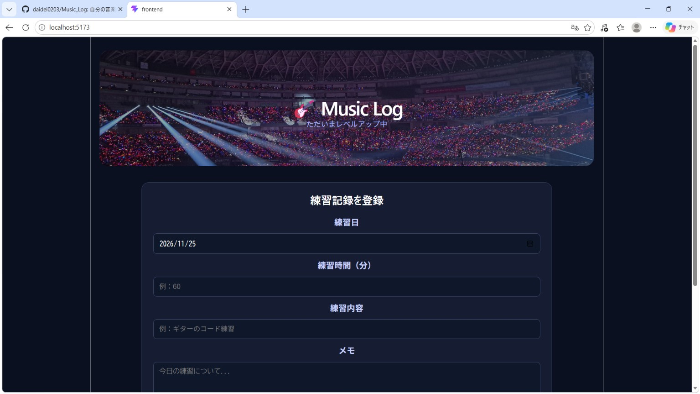
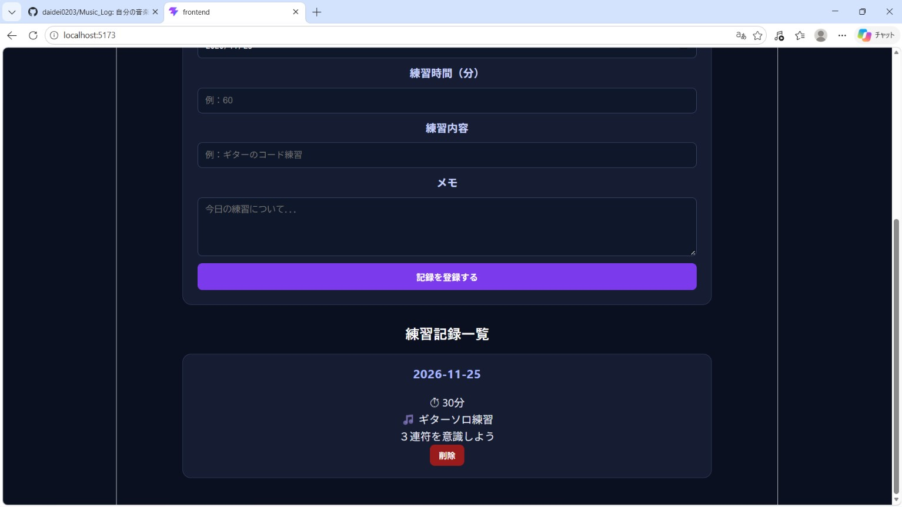

# 🎸 Music Log

自分の音楽練習を記録して、日々の成長を振り返るアプリ

## 概要

Music Logは、個人で使用する音楽練習記録アプリです。
日々の練習内容や練習時間を記録し、過去の練習を振り返ることができます。

## 開発背景

ギターの練習を続ける中で、どのくらい練習したのか、
何を練習したのかを記録し、自分がサボっていないかを振り返りたいと思い開発しました。

日々ギターの練習をしている中で、練習した内容や練習時間を記録し、自分の成長を振り返りたいと考えました。
今回のアプリ開発に良いかなと思い自分専用の練習記録アプリ「Music Log」を開発しました。

ターゲットは、ギターなどの楽器を練習している個人で、練習内容や時間を記録し、日々の努力や成長を振り返りたい人です。

開発では、ReactとSpring Boot、MySQLを連携させることに苦労しました。フロントエンドからAPIを通してデータを登録・表示・削除できるように、各機能の動作を確認しながら実装しました。また、初めて扱う技術も多かったため、エラーが発生した際は自分で考え詰まりそうになったらAI君に聞いて一緒に原因を調べ、一つずつ解決しながら開発を進めました。
## 主な機能

- 練習記録の登録
- 練習記録の一覧表示
- 練習記録の削除
- 練習日・練習時間・練習内容・メモの管理

## 使用技術

### フロントエンド
- React
- Vite
- JavaScript

### バックエンド
- Java
- Spring Boot

### データベース
- MySQL

## 開発環境

- Visual Studio Code
- Git
- GitHub
## データベース設計

### ER図

```mermaid
erDiagram
    PRACTICE_RECORDS {
        BIGINT id PK
        VARCHAR practice_date
        INTEGER duration_minutes
        VARCHAR content
        VARCHAR memo
    }
    ```

## 起動方法

### バックエンド

1. MySQLを起動する
2.  backendフォルダでターミナルを開く
3. `.\mvnw.cmd spring-boot:run` を実行する
### フロントエンド

1. frontendフォルダでターミナルを開く
2. npm installを実行する
3. npm run devを実行する
4. 表示されたURLにアクセスする

## 今後の改善予定

- 練習記録の編集機能
- 練習時間の集計機能
- 練習履歴の振り返り機能
## データベース構成

練習記録を管理するテーブルを使用しています。

| カラム | 内容 |
|---|---|
| id | 練習記録ID |
| practice_date | 練習日 |
| duration_minutes | 練習時間（分） |
| content | 練習内容 |
| memo | メモ |

## 画面イメージ

### 練習記録の登録画面
練習日・練習時間・練習内容・メモを入力して記録を登録します。



### 練習記録一覧画面
登録した練習記録を確認し、不要な記録を削除できます。

